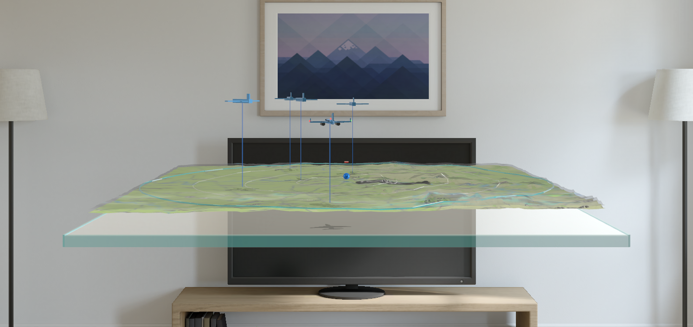
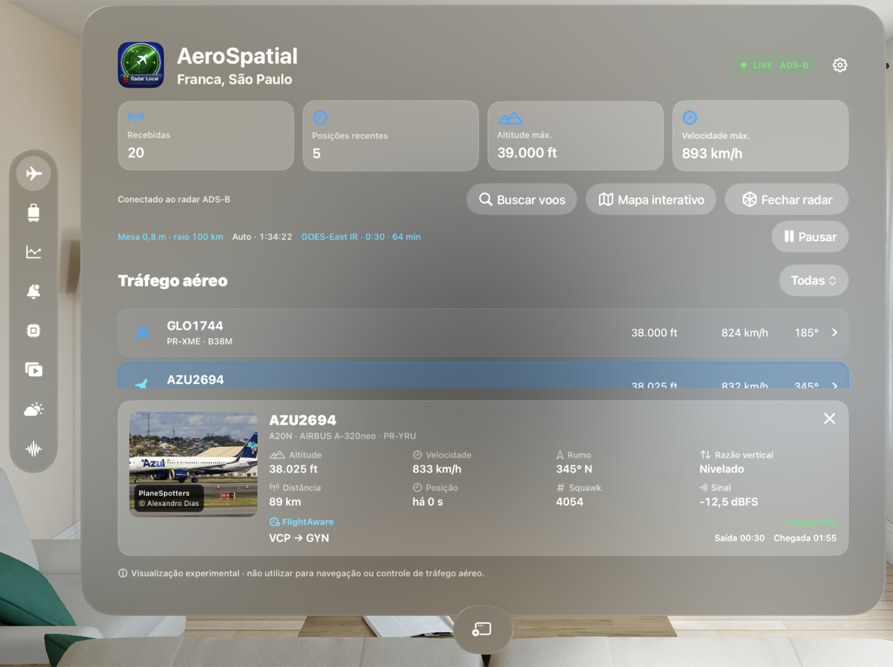
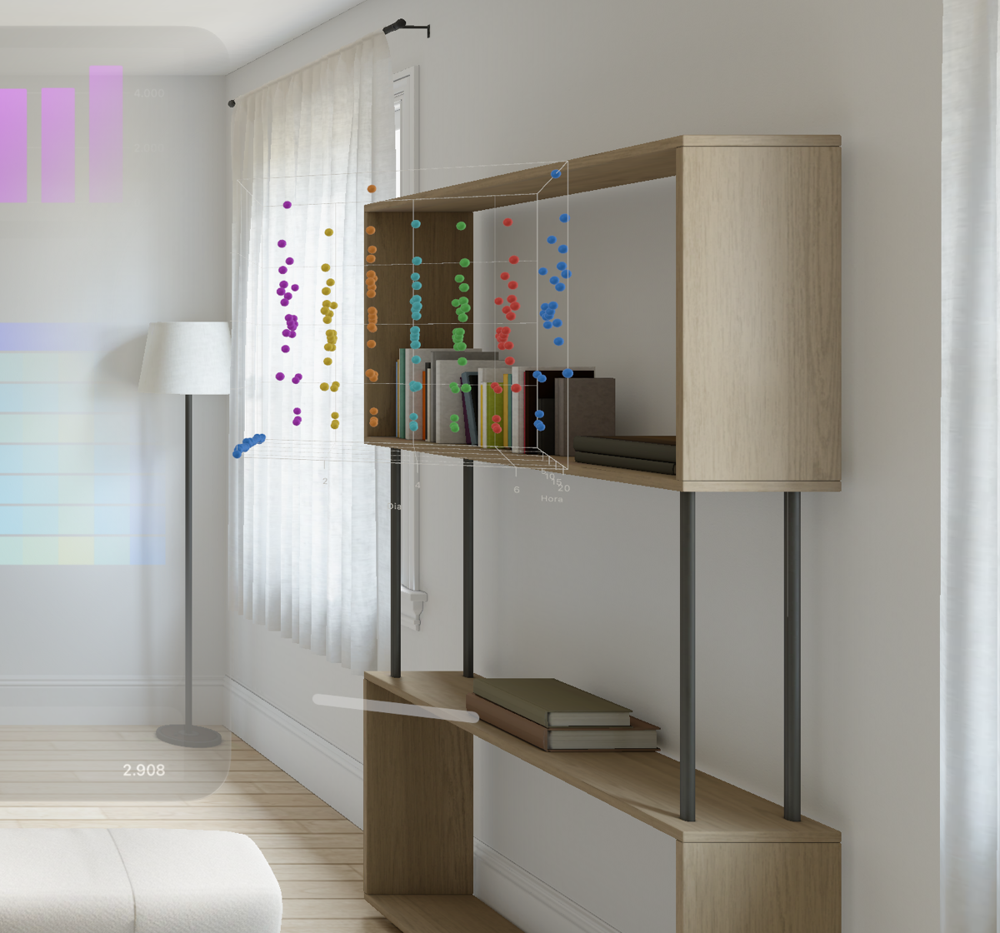
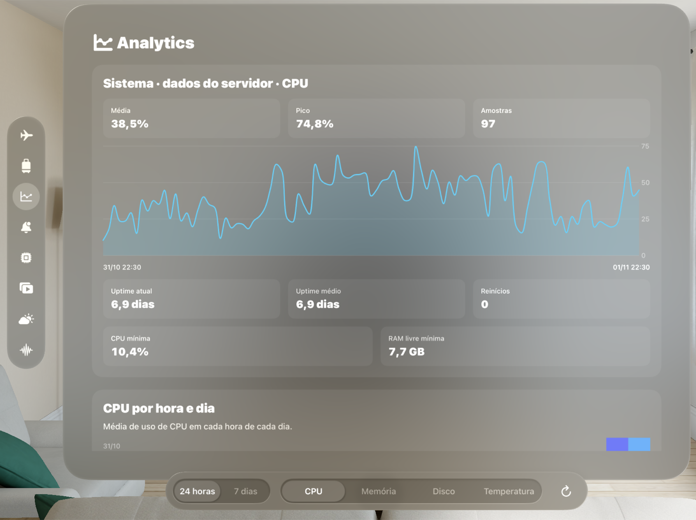
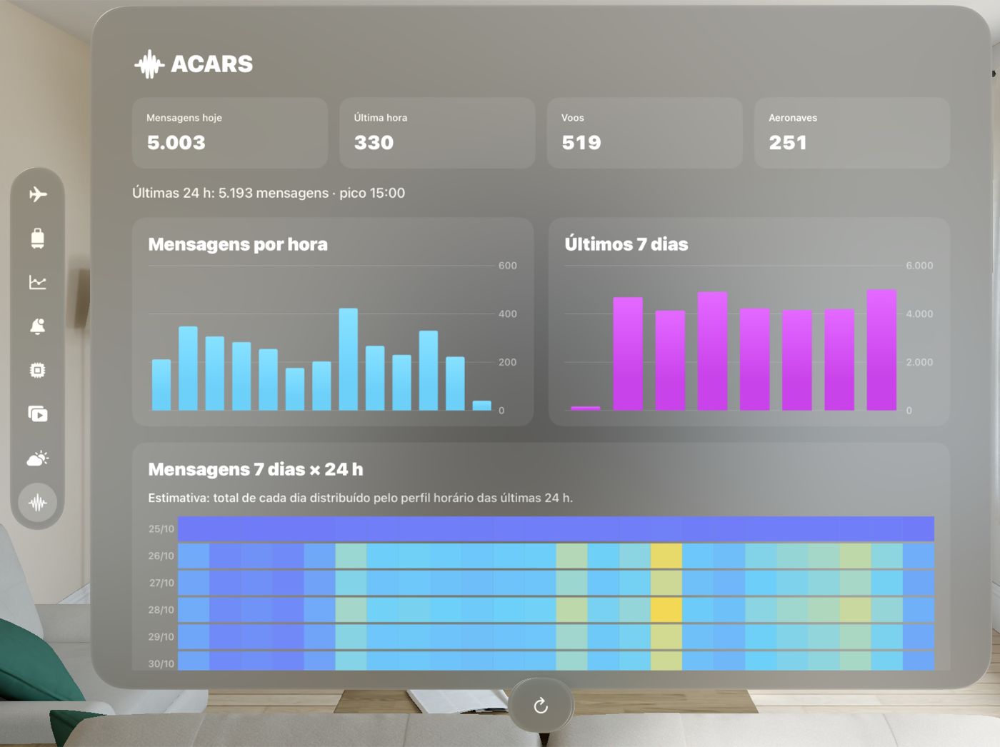
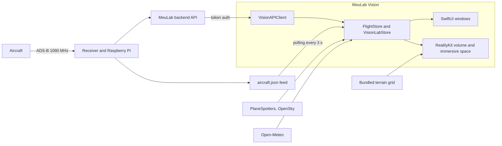

# MeuLab Vision

**A live 3D air traffic radar for Apple Vision Pro, fed by a real ADS-B receiver.**

[Leia em português](README.pt-BR.md)

MeuLab Vision is a native visionOS app. It places a tabletop radar in your room, with aircraft from a local ADS-B receiver flying over real terrain, next to a control panel for the home lab that runs the receiver.



| Mission control | Day × hour chart in 3D |
| --- | --- |
|  |  |
| **Analytics** | **ACARS with heatmap** |
|  |  |

Captured in the visionOS simulator, with live data from the receiver. The interface is in Portuguese.

## Features

- **3D radar volume:** RealityKit table with a MapKit texture draped over real elevation data, procedural aircraft models, labels and session trails. Table size and range (50, 100 or 200 km) are adjustable.
- **Immersive mode:** places the radar on a real table in the room.
- **Aircraft details:** photos, identification and flight data for the selected aircraft.
- **Interactive map and flight search:** map styles, airports and tracking, plus search by flight number, registration or ICAO code.
- **Lab panels:** system, infrastructure (Docker, systemd, disks), analytics, alerts, ACARS, radio, series and weather.
- **Day × hour charts:** heatmaps in the window, with a rotatable Chart3D view in its own volume.
- **Platform integration:** widgets, App Intents, SharePlay, spatial audio, notifications and VoiceOver chart descriptions.

The app only shows data it really received. Aircraft trails start when the app opens, and a failed source shows its own error instead of invented values.

## Architecture



| Path | Contents |
| --- | --- |
| `Sources/Radar` | Radar volume, geodesy, aircraft models, map and flight search |
| `Sources/Immersive` | Immersive space and table placement |
| `Sources/Lab` | Lab panels and charts |
| `Sources/Core` | API client and formatters |
| `MeuLabCore` | Swift package with shared models |
| `Widgets`, `Shared` | WidgetKit extension and shared snapshot |
| `Tests`, `UITests` | Swift Testing suites with JSON fixtures, and XCTest UI tests |
| `Scripts` | Terrain grid generator |

## Run it

You need Xcode 27 with the visionOS 27 runtime, and [XcodeGen](https://github.com/yonaskolb/XcodeGen) if you change `project.yml`.

```bash
git clone https://github.com/eliel9012/meulab-vision.git
cd meulab-vision
cp Secrets.plist.example Secrets.plist
open MeuLabVision.xcodeproj
```

Select the `MeuLabVision` scheme and run it on the Apple Vision Pro simulator.

**This repository does not include the backend.** Without a compatible API in `Secrets.plist`, the lab panels show a connection error. The radar reads the author's receiver feed, set in the source. To sign for a real device, choose your own team in Xcode.

**The Trip section needs a personal file.** `Resources/TripItinerary.json` is kept out of git, so a clean build shows that no itinerary was found.

## Tests

```bash
xcodebuild test -project MeuLabVision.xcodeproj -scheme MeuLabVision -destination 'platform=visionOS Simulator,name=Apple Vision Pro'
```

```bash
xcodebuild test -project MeuLabVision.xcodeproj -scheme MeuLabVisionUITests -destination 'platform=visionOS Simulator,name=Apple Vision Pro'
```

The suite has 235 unit tests and 10 UI tests. In a clean checkout, 3 unit tests and 1 UI test are skipped because they need the personal itinerary.

The UI tests need network access and a configured backend.

## Security

The API token is read from `Secrets.plist`, which git ignores, but it is copied into the app bundle at build time, so anyone holding a build can extract it. This suits a personal app. A public release would need per-user authentication on the backend.

## Credits

- Elevation: [Terrain Tiles on AWS](https://registry.opendata.aws/terrain-tiles/) by Mapzen, with SRTM data courtesy of the USGS.
- Aircraft photos: [PlaneSpotters](https://www.planespotters.net/) and [OpenSky Network](https://opensky-network.org/).
- Weather: [Open-Meteo](https://open-meteo.com/).
- Developed with AI assistance from Claude Code.

## Disclaimer

Experimental visualization. Do not use it for navigation or air traffic control.

## License

[MIT](LICENSE)
