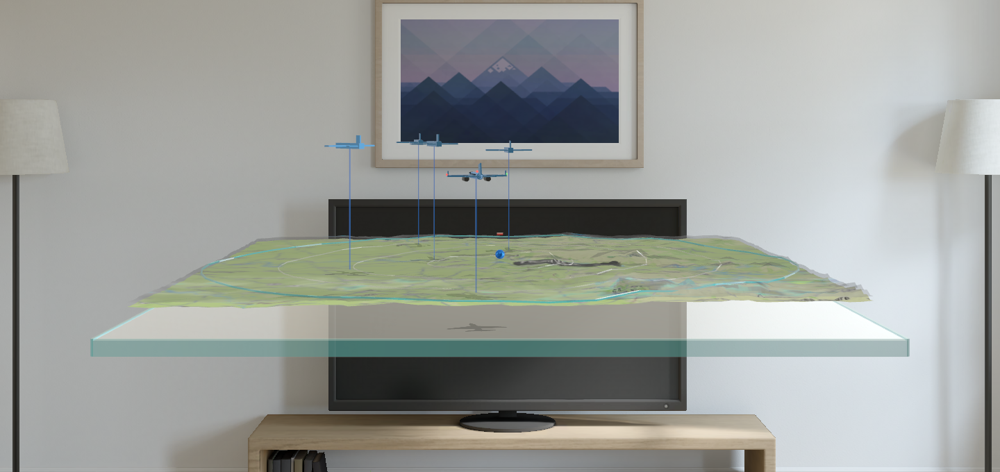
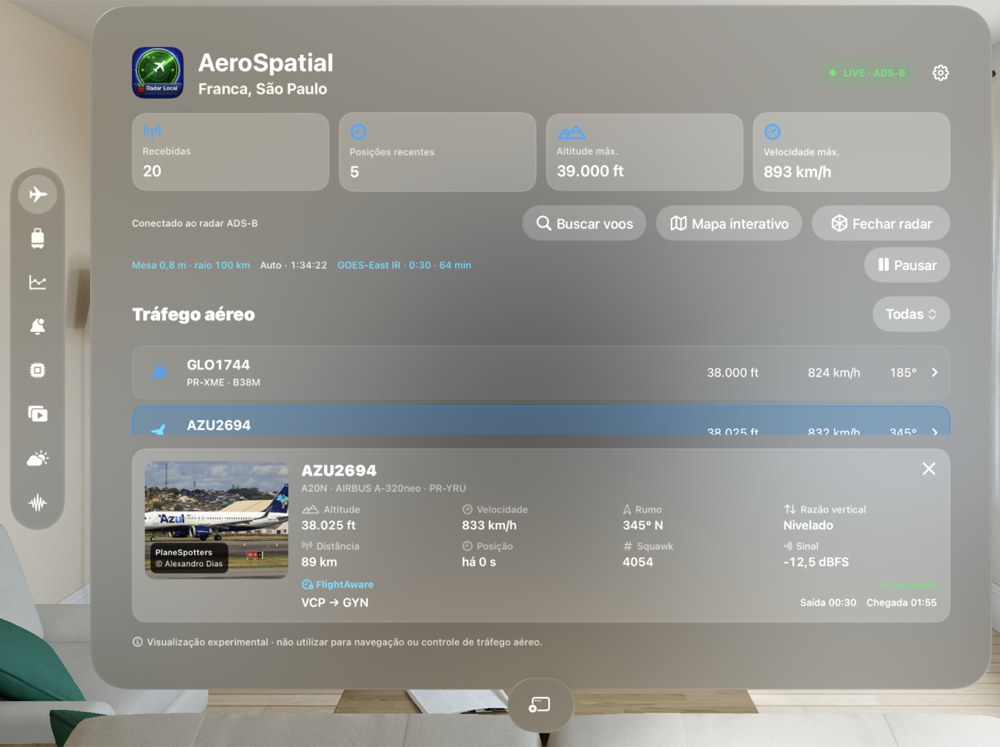
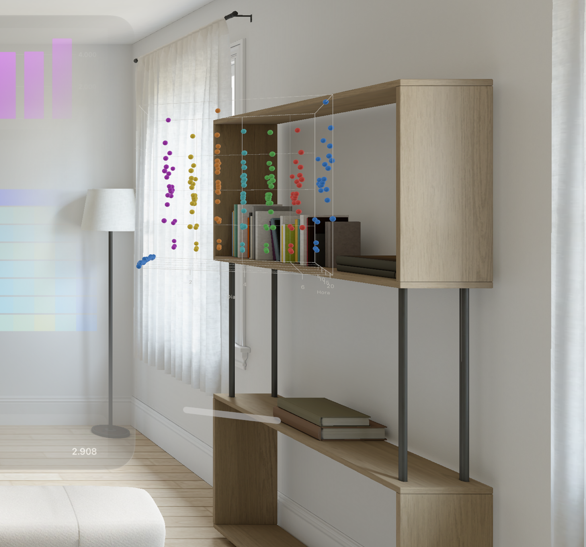
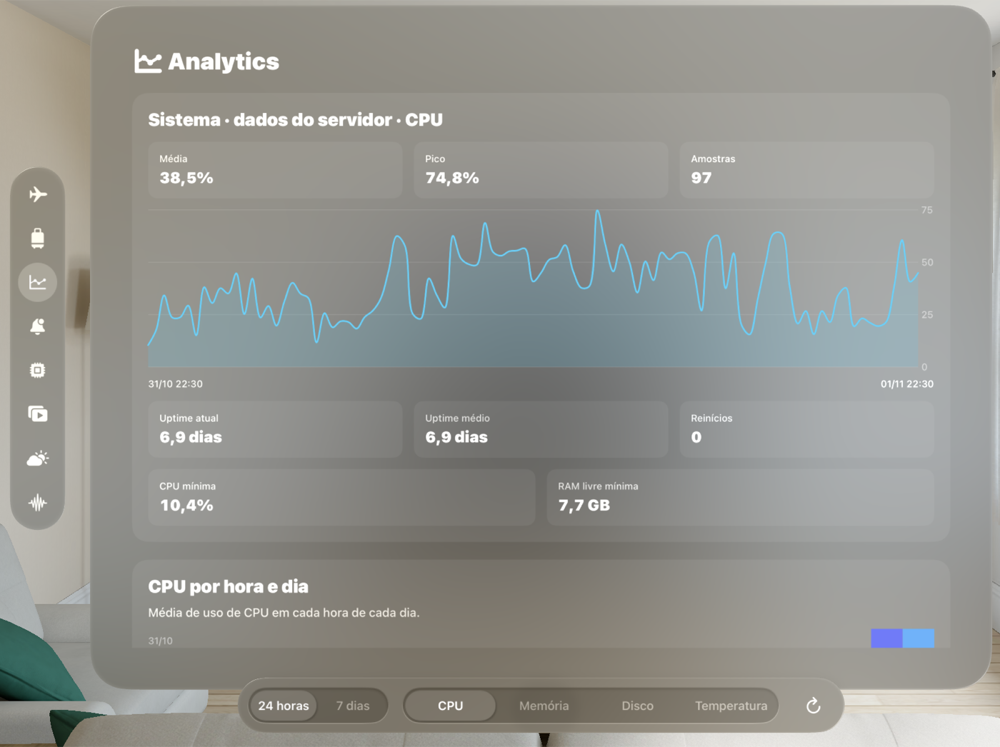
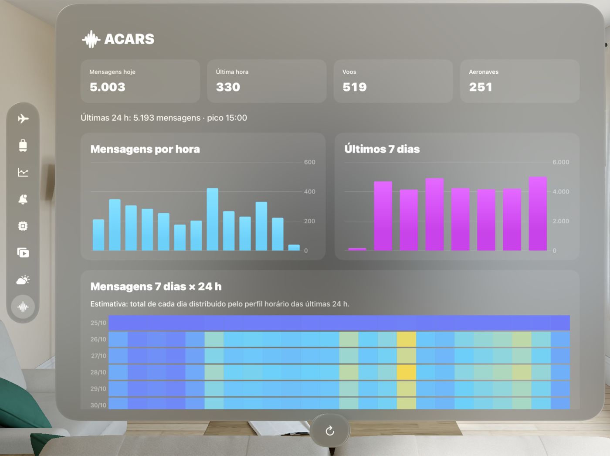
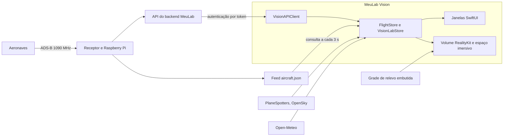

# MeuLab Vision

**Radar 3D de tráfego aéreo em tempo real para Apple Vision Pro, alimentado por um receptor ADS-B real.**

[Read in English](README.md)

MeuLab Vision é um app nativo para visionOS. Ele coloca um radar de mesa na sua sala, com aeronaves captadas por um receptor ADS-B local voando sobre relevo real, ao lado de um painel de controle do laboratório doméstico que roda o receptor.



| Central | Gráfico dia × hora em 3D |
| --- | --- |
|  |  |
| **Analytics** | **ACARS com heatmap** |
|  |  |

Capturas do simulador do visionOS, com dados reais do receptor.

## Funcionalidades

- **Volume de radar 3D:** mesa em RealityKit com textura do MapKit sobre dados reais de elevação, modelos procedurais de aeronaves, rótulos e trilhas da sessão. Tamanho da mesa e alcance (50, 100 ou 200 km) são ajustáveis.
- **Modo imersivo:** posiciona o radar sobre uma mesa real da sala.
- **Detalhes da aeronave:** fotos, identificação e dados de voo da aeronave selecionada.
- **Mapa interativo e busca de voos:** estilos de mapa, aeroportos e seguimento, além de busca por número de voo, matrícula ou código ICAO.
- **Painéis do laboratório:** sistema, infraestrutura (Docker, systemd, discos), analytics, alertas, ACARS, rádio, séries e clima.
- **Gráficos dia × hora:** heatmaps na janela, com visão giratória em Chart3D em um volume próprio.
- **Integração com a plataforma:** widgets, App Intents, SharePlay, áudio espacial, notificações e descrição de gráficos para VoiceOver.

O app só mostra dados realmente recebidos. As trilhas começam quando o app abre, e uma fonte com falha mostra o próprio erro em vez de valores inventados.

## Arquitetura



| Pasta | Conteúdo |
| --- | --- |
| `Sources/Radar` | Volume do radar, geodésia, modelos de aeronaves, mapa e busca de voos |
| `Sources/Immersive` | Espaço imersivo e posicionamento na mesa |
| `Sources/Lab` | Painéis do laboratório e gráficos |
| `Sources/Core` | Cliente da API e formatadores |
| `MeuLabCore` | Pacote Swift com modelos compartilhados |
| `Widgets`, `Shared` | Extensão WidgetKit e snapshot compartilhado |
| `Tests`, `UITests` | Suítes em Swift Testing com fixtures JSON e testes de UI em XCTest |
| `Scripts` | Gerador da grade de relevo |

## Como rodar

Você precisa do Xcode 27 com o runtime do visionOS 27, e do [XcodeGen](https://github.com/yonaskolb/XcodeGen) se alterar o `project.yml`.

```bash
git clone https://github.com/eliel9012/meulab-vision.git
cd meulab-vision
cp Secrets.plist.example Secrets.plist
open MeuLabVision.xcodeproj
```

Selecione o esquema `MeuLabVision` e execute no simulador Apple Vision Pro.

**Este repositório não inclui o backend.** Sem uma API compatível no `Secrets.plist`, os painéis do laboratório mostram erro de conexão. O radar lê o feed do receptor do autor, definido no código. Para assinar em um aparelho real, escolha o seu time no Xcode.

**A seção Viagem precisa de um arquivo pessoal.** `Resources/TripItinerary.json` fica fora do git, então um build limpo mostra que não há roteiro.

## Testes

```bash
xcodebuild test -project MeuLabVision.xcodeproj -scheme MeuLabVision -destination 'platform=visionOS Simulator,name=Apple Vision Pro'
```

```bash
xcodebuild test -project MeuLabVision.xcodeproj -scheme MeuLabVisionUITests -destination 'platform=visionOS Simulator,name=Apple Vision Pro'
```

São 235 testes unitários e 10 testes de UI. Em um checkout limpo, 3 testes unitários e 1 de UI são pulados porque precisam do roteiro pessoal.

Os testes de UI precisam de rede e de um backend configurado.

## Segurança

O token da API é lido do `Secrets.plist`, ignorado pelo git, mas é copiado para o bundle do app no build, então quem tiver um build consegue extraí-lo. Isso serve para um app pessoal. Uma versão pública precisaria de autenticação por usuário no backend.

## Créditos

- Elevação: [Terrain Tiles na AWS](https://registry.opendata.aws/terrain-tiles/), da Mapzen, com dados SRTM cortesia do USGS.
- Fotos de aeronaves: [PlaneSpotters](https://www.planespotters.net/) e [OpenSky Network](https://opensky-network.org/).
- Clima: [Open-Meteo](https://open-meteo.com/).
- Desenvolvido com assistência de IA do Claude Code.

## Aviso

Visualização experimental. Não use para navegação ou controle de tráfego aéreo.

## Licença

[MIT](LICENSE)
